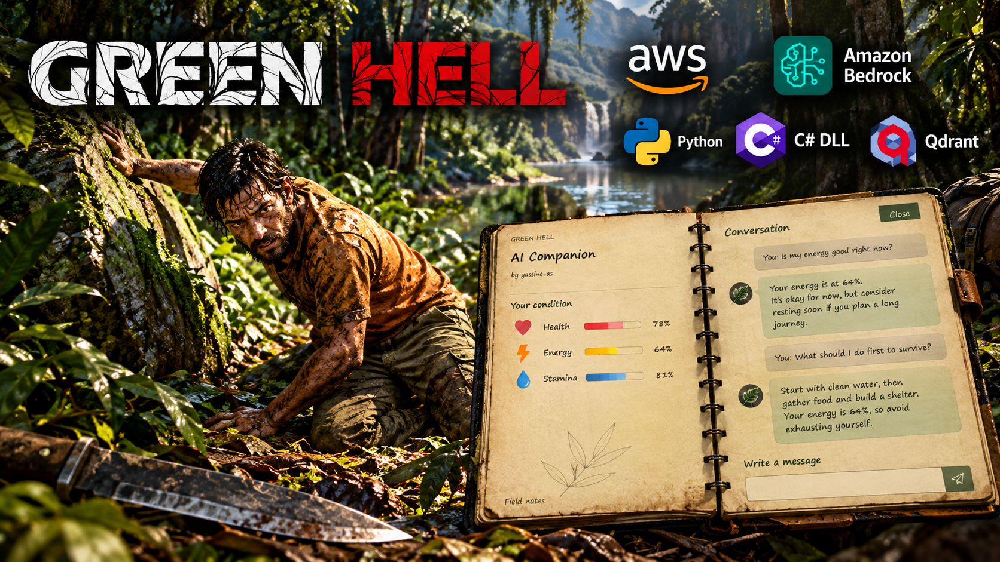
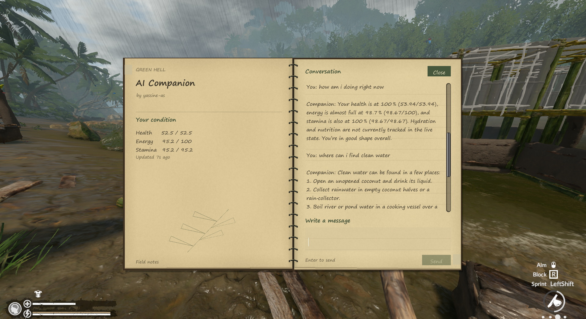
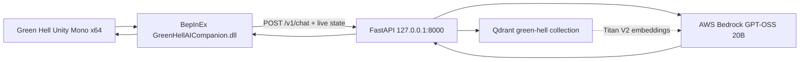

# Green Hell AI Companion



Green Hell AI Companion is a local BepInEx plugin and FastAPI service that gives Green Hell players a private survival journal. The notebook reads the player’s live health, energy, and stamina, sends questions to a local backend, retrieves relevant Green Hell knowledge from Qdrant, and generates a grounded answer with AWS Bedrock GPT-OSS 20B.

The project targets Windows, Green Hell Unity Mono x64, and BepInEx 5.4.23.5. It does not include Green Hell files, Unity assemblies, BepInEx binaries, or proprietary decompiled source.

## Preview

The supplied banner is a project illustration for the repository landing page. It is not evidence of a live in-game capture. The Unity notebook uses an aged-paper journal layout with two pages, binding rings, ruled notes, a live condition panel, conversation history, and a message editor. Add real in-game screenshots to `screenshots/` before publishing; the repository does not fabricate runtime captures.



This image is an offline design preview. It is not evidence of a live in-game capture.

## Features and limitations

- F8 toggles the private survival journal open and closed.
- Escape and Close close the journal; reopening preserves history for the current player.
- Read-only health, energy, and stamina telemetry.
- Local FastAPI bridge at `http://127.0.0.1:8000`.
- Qdrant retrieval with section and game-mode metadata.
- Bedrock GPT-OSS 20B answers grounded in retrieved Green Hell knowledge.
- Titan Text Embeddings V2 knowledge ingestion.
- Safe assistant Markdown rendering for bold and italic text.
- Client-side typewriter presentation after a complete backend response.

Runtime validation still requires a manual Green Hell test. AWS credentials and Bedrock permissions are required for live answers, and AWS usage can incur charges. The plugin does not pause the world or change saves. Backend token streaming is not enabled; the completed answer is animated locally.

## Architecture



## Prerequisites

- Windows 10/11 x64.
- A legally installed Steam copy of Green Hell.
- BepInEx 5 x64 Mono 5.4.23.5.
- Python 3.12 or newer.
- Docker Desktop with Docker Compose.
- AWS Bedrock access to `openai.gpt-oss-20b-1:0` and `amazon.titan-embed-text-v2:0` in `us-east-1`.

## Quick start

From PowerShell in this repository:

```powershell
python -m venv .venv
.\.venv\Scripts\Activate.ps1
pip install -r backend\requirements.txt
Copy-Item .env.example .env
docker compose up -d qdrant
$env:PYTHONPATH = (Get-Location).Path + '\backend'
python scripts\ingest_knowledge.py 'C:\path\to\GreenHell_AI_RAG_Full_Knowledge.md'
python -m uvicorn app.main:app --host 127.0.0.1 --port 8000
```

Copy `releases\GreenHellAICompanion.dll` to the game plugin directory, then launch Green Hell.

## Backend installation and commands

```powershell
.\Makefile.ps1 install
.\Makefile.ps1 qdrant-up
.\Makefile.ps1 qdrant-status
.\Makefile.ps1 ingest
.\Makefile.ps1 api
.\Makefile.ps1 test
```

The `ingest` target reads `knowledge\GreenHell_AI_RAG_Full_Knowledge.md` by default. To use another file:

```powershell
$env:PYTHONPATH = (Get-Location).Path + '\backend'
python scripts\ingest_knowledge.py 'C:\path\to\knowledge.md'
```

Ingestion creates or replaces the configured cosine collection, splits Markdown by gameplay headings, preserves section and mode metadata, embeds chunks with Titan V2, and skips ingestion or AI-instruction sections.

## Configuration

Copy `.env.example` to `.env`. Never commit `.env` or paste credentials into source control.

```ini
AWS_ACCESS_KEY_ID=
AWS_SECRET_ACCESS_KEY=
AWS_REGION=us-east-1
BEDROCK_MODEL_ID=openai.gpt-oss-20b-1:0
BEDROCK_EMBEDDING_MODEL_ID=amazon.titan-embed-text-v2:0
EMBEDDING_DIMENSIONS=1024
BEDROCK_GUARDRAIL_ID=
BEDROCK_GUARDRAIL_VERSION=1
QDRANT_URL=http://localhost:6333
QDRANT_COLLECTION=green-hell
RAG_TOP_K=5
RAG_CHUNK_SIZE=1000
RAG_CHUNK_OVERLAP=150
API_HOST=127.0.0.1
API_PORT=8000
```

Use an AWS profile, environment variables, or an IAM role instead of storing keys in `.env`. Rotate credentials that have been exposed.

## Qdrant

```powershell
docker compose up -d qdrant
Invoke-RestMethod http://localhost:6333/collections | ConvertTo-Json -Depth 5
docker compose logs -f --tail=100 qdrant
```

## FastAPI API

Health check:

```powershell
Invoke-RestMethod http://127.0.0.1:8000/health | ConvertTo-Json
```

Example request:

```powershell
$body = @{
  message = 'What should I do before drinking water?'
  state = @{
    health = 80; max_health = 100
    energy = 50; max_energy = 100
    stamina = 52; max_stamina = 64
    mode = 'Survival'
  }
} | ConvertTo-Json -Depth 6
Invoke-RestMethod http://127.0.0.1:8000/v1/chat -Method Post -ContentType 'application/json' -Body $body | ConvertTo-Json -Depth 8
```

The response contract is `{ answer, sources, model }`. Reasoning blocks are removed structurally before `answer` is returned. Percentages are calculated from current/max values, so stamina `52/64` is `81.25%`.

## DLL installation

1. Install BepInEx 5 x64 Mono for Green Hell.
2. Launch Green Hell once and exit so BepInEx creates its folders.
3. Copy `releases\GreenHellAICompanion.dll` to `Green Hell\BepInEx\plugins\GreenHellAICompanion.dll`.
4. Start Qdrant and FastAPI.
5. Launch Green Hell and load a save.
6. Press F8 to open or close the journal.
7. Type a question and press Enter or Send.

Do not bundle Green Hell assemblies, saves, or proprietary decompiled source.

## Build the C# plugin

The source is in `mod\src`. Build against read-only working copies of the inspected Unity managed assemblies and BepInEx core:

```powershell
.\mod\Build.ps1 `
  -GameManagedPath 'C:\analysis\managed-copy' `
  -BepInExCorePath 'C:\analysis\BepInEx-5.4.23.5\BepInEx\core' `
  -BuildDirectory '.\mod\.build'
.\mod\Test-Policies.ps1
```

The build uses the Windows .NET Framework compiler, x64, C# 5, and warnings as errors. It writes the build output under `mod\GreenHellAI.dll` and never writes to the game installation. Copy a reviewed build to `releases\GreenHellAICompanion.dll` for distribution.

## Example questions

- “My stamina is low. What should I prioritize?”
- “How do I make water safer in Survival mode?”
- “Where should I look for materials for a small shelter?”
- “Give me a three-step plan for food and hydration.”

## Troubleshooting

- **F8 does nothing:** confirm BepInEx x64 Mono is initialized, check `BepInEx\LogOutput.log`, and verify the plugin is in `BepInEx\plugins`.
- **Unavailable response:** check `http://127.0.0.1:8000/health`, Qdrant status, AWS region, and Bedrock permissions.
- **No knowledge results:** start Qdrant and rerun ingestion.
- **Controls do not restore immediately:** release F8 and mouse buttons; the focus lease waits for neutral input frames.
- **Build fails:** verify the Unity managed-copy and BepInEx core paths.

## Security, credits, and disclaimer

`.env`, AWS credentials, virtual environments, logs, caches, databases, and private game files are ignored. Never commit access keys, save files, proprietary assemblies, or decompiled game source. The backend listens on `127.0.0.1` by default. Bedrock and embedding calls may incur charges.

Author: **Yassine Ait Sidi Brahim**.

